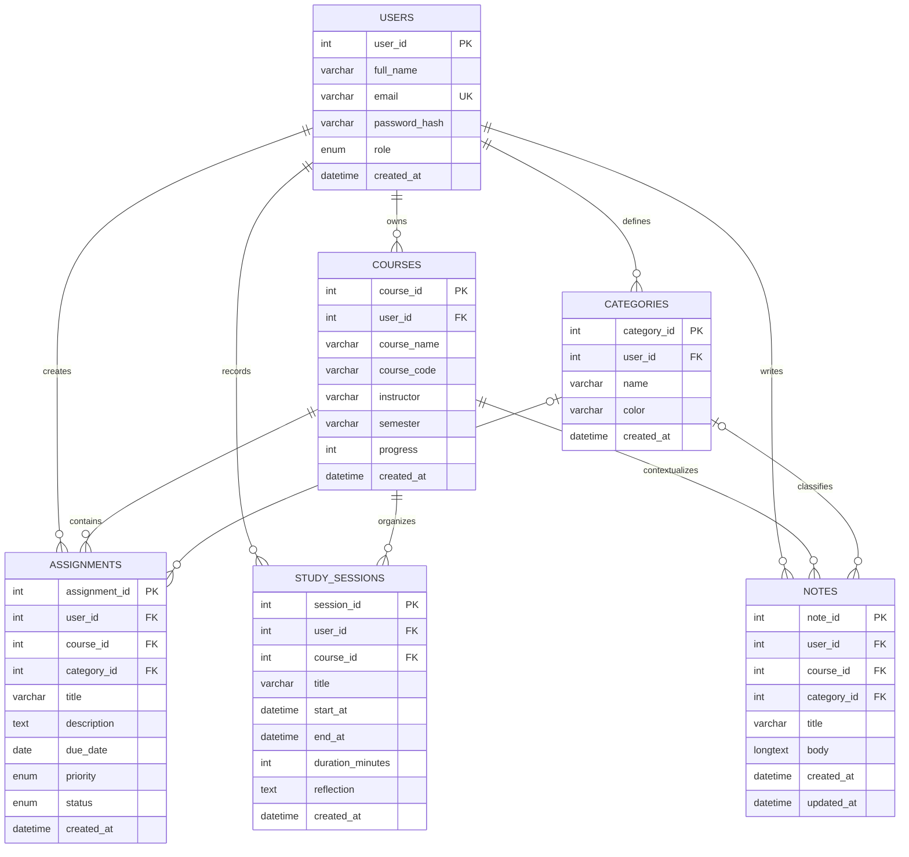

# StudyFlow draft Entity-Relationship Diagram

The draft has six core entities. Each user owns their courses, assignments, sessions, notes and categories. Course, assignment, session and note records are associated with their owning user to support authorization and data isolation. Category links are optional so an item can exist before categorization.

## Relationship and integrity notes
- One user owns many courses, assignments, study sessions, notes and categories.
- One course can be associated with many assignments, study sessions and notes.
- One category can classify many assignments and notes; category references are nullable.
- Use `ON DELETE CASCADE` for user-owned records only if the intended account-deletion policy is confirmed. For course deletion, decide whether to restrict deletion or set dependent course references to `NULL`.
- Enforce unique email addresses and validate that referenced records belong to the same user. Cross-owner consistency is an application-level service rule (or can be strengthened with composite keys).
- This is a draft for Milestone 1; physical SQL implementation belongs to Milestone 2.
